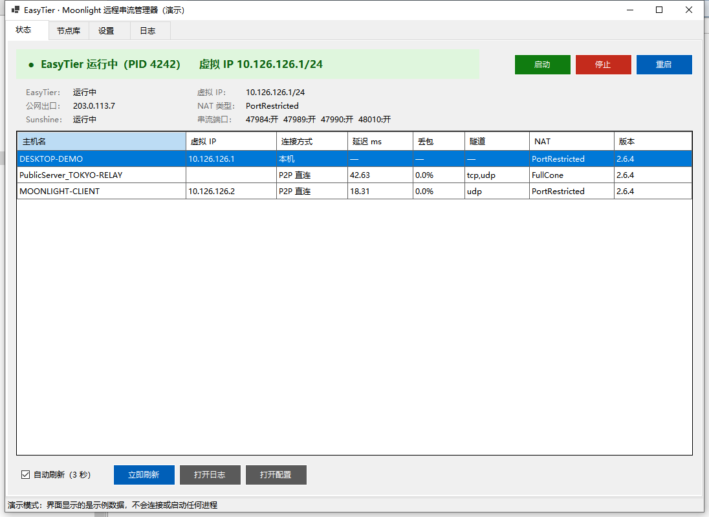
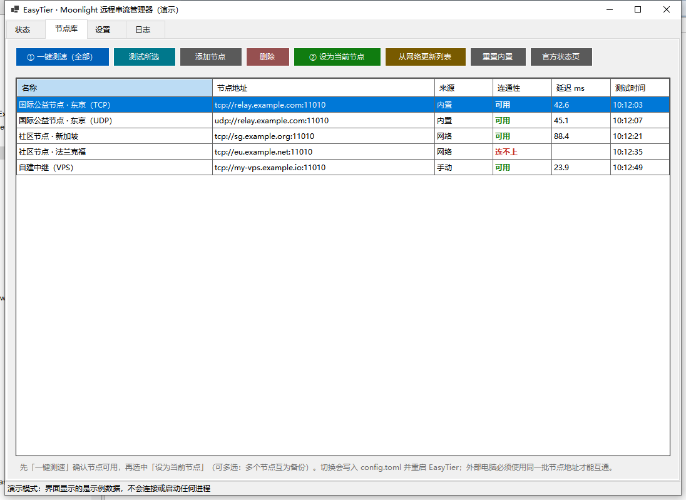
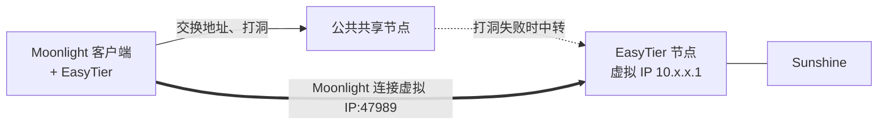

# EasyTier Moonlight 远程串流管理器

[](https://github.com/akizono/EasyTierMoonlightManager/actions/workflows/build.yml)

一个 Windows 桌面程序，用来管理 EasyTier 组网，让没有公网 IPv4 的机器也能用 Moonlight 串流。

程序负责读写 EasyTier 配置、启动和停止 `easytier-core`、显示节点与连接状态，并检查 Sunshine 的运行状态和监听端口。



## 功能

| 功能 | 说明 |
| --- | --- |
| 状态查看 | EasyTier 进程状态、虚拟 IP、公网出口、NAT 类型、Sunshine 服务与端口、在线节点数 |
| 连接列表 | 每个节点的连接方式（P2P 直连或中继）、延迟、丢包、隧道协议、对端 NAT、版本 |
| 节点测速 | 起一个临时 EasyTier 实例实际握手，判断节点是否可用并读取延迟，不影响正在运行的连接 |
| 切换节点 | 可多选，写入配置后重启 EasyTier；新配置无法启动时自动回滚到上一份 |
| 节点管理 | 内置一份常用公共节点，支持从网页抓取地址、手动添加和删除 |
| 网络参数 | 在界面修改网络名、密钥、虚拟 IP，保存并重启后生效 |
| Sunshine 配置 | 切换 `origin_web_ui_allowed`（`wan` / `lan`），用于在局域网外打开 Web 控制台输入配对码 |
| 日志 | 查看 `easytier.log` 末尾内容 |

程序不联网（只有点“从网络更新列表”时会访问公开页面），不写注册表，不注册 Windows 服务或计划任务。



## 工作原理



EasyTier 负责把两台机器放进同一个虚拟局域网。配置里的节点只用于交换地址和协助 NAT 打洞；打洞成功后两端直连，流量不经过节点，打洞失败才由节点转发。

Moonlight 直接连接主机的虚拟 IP，所以 Sunshine 需要监听 `0.0.0.0`，本机防火墙也要放行它的端口。

## 环境要求

| 依赖 | 说明 |
| --- | --- |
| Windows 10 / 11 x64 | 需要管理员权限，用于创建虚拟网卡和修改 Sunshine 配置 |
| [.NET 10 Desktop Runtime](https://dotnet.microsoft.com/download/dotnet/10.0) | 运行已编译版本需要 |
| [EasyTier](https://github.com/EasyTier/EasyTier/releases) 2.6 或以上 | 提供 `easytier-core.exe` 和 `easytier-cli.exe` |
| [Sunshine](https://github.com/LizardByte/Sunshine) | 串流主机端 |
| [Moonlight](https://moonlight-stream.org/) | 串流客户端 |

仓库里没有 EasyTier 和 Sunshine 的二进制文件，需要单独安装。

## 下载与构建

已经编译好的版本见 [Releases](https://github.com/akizono/EasyTierMoonlightManager/releases)：

| 文件 | 说明 |
| --- | --- |
| `EasyTierMoonlightManager-v1.0.0-win-x64.exe` | 约 240 KB，需要先安装 .NET 10 桌面运行时 |
| `EasyTierMoonlightManager-v1.0.0-win-x64-selfcontained.exe` | 约 47 MB，自带运行时，不需要额外安装 |

自行构建：

```powershell
# 调试运行
dotnet run --project EasyTierMoonlightManager.csproj

# 发布单文件（依赖已安装的 .NET 10 运行时，约 240 KB）
dotnet publish EasyTierMoonlightManager.csproj -c Release -r win-x64 `
  -p:SelfContained=false -p:PublishSingleFile=true -o dist
```

生成的文件是 `dist\EasyTierMoonlightManager.exe`，双击运行，UAC 选择“是”。

## 使用

### 主机端

1. 准备 `%ProgramData%\EasyTier\config.toml`，填写网络名称、网络密钥、虚拟 IP 和节点地址。也可以先在 EasyTier 官方 GUI 里建好配置再导出。
2. 放行防火墙（管理员 PowerShell）：

   ```powershell
   New-NetFirewallRule -DisplayName 'Sunshine-TCP' -Direction Inbound -Action Allow -Protocol TCP -LocalPort 47984,47989,47990,48010 -Profile Any
   New-NetFirewallRule -DisplayName 'Sunshine-UDP' -Direction Inbound -Action Allow -Protocol UDP -LocalPort 47998-48002 -Profile Any
   New-NetFirewallRule -DisplayName 'EasyTier-P2P' -Direction Inbound -Action Allow -Protocol TCP -LocalPort 11010 -Profile Any
   New-NetFirewallRule -DisplayName 'EasyTier-P2P-UDP' -Direction Inbound -Action Allow -Protocol UDP -LocalPort 11010 -Profile Any
   ```

3. 打开程序，在“设置”里确认网络参数，在“状态”页点“启动”。
4. 在“设置”里勾选“允许虚拟局域网访问 Web 控制台”，点“应用”。这一步会修改 Sunshine 的配置文件并重启服务。

### 客户端

1. 安装 EasyTier，加入同一个网络（网络名称、密钥、节点地址与主机一致），虚拟 IP 用同一网段的另一个地址。
2. 确认 `ping <主机虚拟 IP>` 能通。
3. 在 Moonlight 里手动添加主机，地址填主机虚拟 IP。自动发现不会跨虚拟网。
4. 按 Moonlight 显示的配对码，在浏览器打开 `https://<主机虚拟IP>:47990`，登录 Sunshine 后输入配对码。

## 界面

| 页签 | 内容 |
| --- | --- |
| 状态 | 运行状态、PID、虚拟 IP、公网出口、NAT、Sunshine 与端口、连接列表；启动、停止、重启；3 秒自动刷新 |
| 节点库 | 节点清单和测速结果；一键测速、测试所选、添加、删除、设为当前节点、从网络更新、打开官方状态页 |
| 设置 | 网络名称、密钥、虚拟 IP 的保存与应用；Sunshine 的 WAN 访问开关；打开配置和日志目录 |
| 日志 | `easytier.log` 末尾 400 行，可用记事本打开 |

连接列表里“连接方式”为 `P2P 直连` 表示两端直连，`中继` 表示打洞失败、流量走公共节点。延迟和丢包可以直接用来判断链路质量。

## 数据文件

运行数据都在 `%ProgramData%\EasyTier\`：

| 文件 | 用途 | 含敏感信息 |
| --- | --- | --- |
| `config.toml` | EasyTier 配置（网络名、密钥、虚拟 IP、节点） | 是 |
| `nodes.json` | 节点清单和测速结果 | 否 |
| `logs\easytier.log` | EasyTier 运行日志 | 可能含 IP |
| `settings.json` | 可选，覆盖默认路径 | 否 |

`config.toml` 里的网络密钥是明文，注意不要外传，也不要提交到仓库（`.gitignore` 已经排除了它）。

`settings.json` 用于 EasyTier 或 Sunshine 不在默认目录的情况，示例见 [docs/settings.example.json](docs/settings.example.json)：

```json
{
  "coreExe": "C:\\Tools\\easytier\\easytier-core.exe",
  "cliExe": "C:\\Tools\\easytier\\easytier-cli.exe",
  "configFile": "C:\\ProgramData\\EasyTier\\config.toml",
  "sunshineConf": "C:\\Program Files\\Sunshine\\config\\sunshine.conf",
  "sunshineService": "SunshineService"
}
```

未提供配置时，程序按以下顺序查找 `easytier-core.exe`：`settings.json`、环境变量 `EASYTIER_HOME`、程序所在目录、`C:\Software\easytier-*`、`Program Files\EasyTier`。

## 命令行参数

| 参数 | 作用 |
| --- | --- |
| 无 | 打开图形界面 |
| `--demo` | 演示模式，显示示例数据，不读取真实配置，不启动任何进程 |
| `--selftest` | 无界面自检，读取状态并测试第一个节点，结果写到 `logs\selftest.txt` |

## 常见问题

**能 ping 通虚拟 IP，但 Moonlight 显示主机离线。**
先确认 Sunshine 正在运行（`Get-Service SunshineService`），再检查防火墙是否放行了 47984、47989、48010 和 UDP 47998-48002。

**打不开 `https://虚拟IP:47990`，没法输入配对码。**
在“设置”里勾选“允许虚拟局域网访问 Web 控制台”，应用后再试。这个选项对应 `origin_web_ui_allowed = wan`。

**延迟偏高，画面卡顿。**
看连接列表里是不是“中继”。中继说明打洞失败，流量在绕公共节点走高延迟线路。可以换一个更近的节点，或者检查两端 NAT 类型，对称型 NAT 打洞成功率较低。

**换节点后连不上。**
“设为当前节点”会先写配置再重启。新配置起不来时程序会自动回滚。建议切换之前先用“测试所选”确认节点可用。

**程序会开机自动启动吗？**
不会。程序不注册服务或计划任务，重启后需要手动打开。需要开机自动连接时可以在任务计划程序里自行添加。

**可以和 EasyTier 官方 GUI 一起用吗？**
不要在同一套配置上同时点“运行网络”，会抢占 11010 端口。官方 GUI 适合查看和导入配置。

## 项目结构

```
EasyTierMoonlightManager/
├─ MainForm.cs                 界面（WinForms，代码布局）
├─ Program.cs                  入口：GUI、--demo、--selftest
├─ Services/
│  ├─ Paths.cs                 路径探测与 settings.json 覆盖
│  ├─ EasyTierService.cs       进程控制、状态解析、节点测速
│  ├─ ConfigEditor.cs          config.toml 读写
│  ├─ NodeStore.cs             节点库持久化
│  ├─ Models.cs                数据模型
│  └─ Proc.cs                  进程执行封装
├─ app.manifest                请求管理员权限
├─ app.noadmin.manifest        免提权清单，仅调试界面时使用
└─ docs/                       截图与示例配置
```

## 已知限制

- 仅支持 Windows，界面基于 WinForms。
- 没有公网 IP 时依赖公共共享节点，节点可用性和带宽不受本项目控制。
- 需要 .NET 10 桌面运行时。需要免安装版本时可以改成自包含发布，体积约 100 MB。
- 节点测速每次约 10 秒，节点较多时耗时较长。

后续计划：防火墙规则检测、节点延迟历史、深色主题、英文界面。

## 许可

MIT License，见 [LICENSE](LICENSE)。

本项目与 EasyTier、Sunshine、Moonlight 官方无关，是第三方管理工具。使用公共节点和开放端口带来的风险由使用者自行承担。

## English

A WinForms tool for Windows that manages EasyTier mesh networking for Moonlight streaming on machines without a public IPv4 address. It shows node status and peer connections, tests relay nodes with a real handshake, switches nodes with automatic rollback, edits network settings, and toggles Sunshine's `origin_web_ui_allowed` so you can pair from outside the LAN.

Build with `dotnet publish -c Release -r win-x64 -p:SelfContained=false -p:PublishSingleFile=true`. No data collection, no services, no scheduled tasks, no registry writes.
